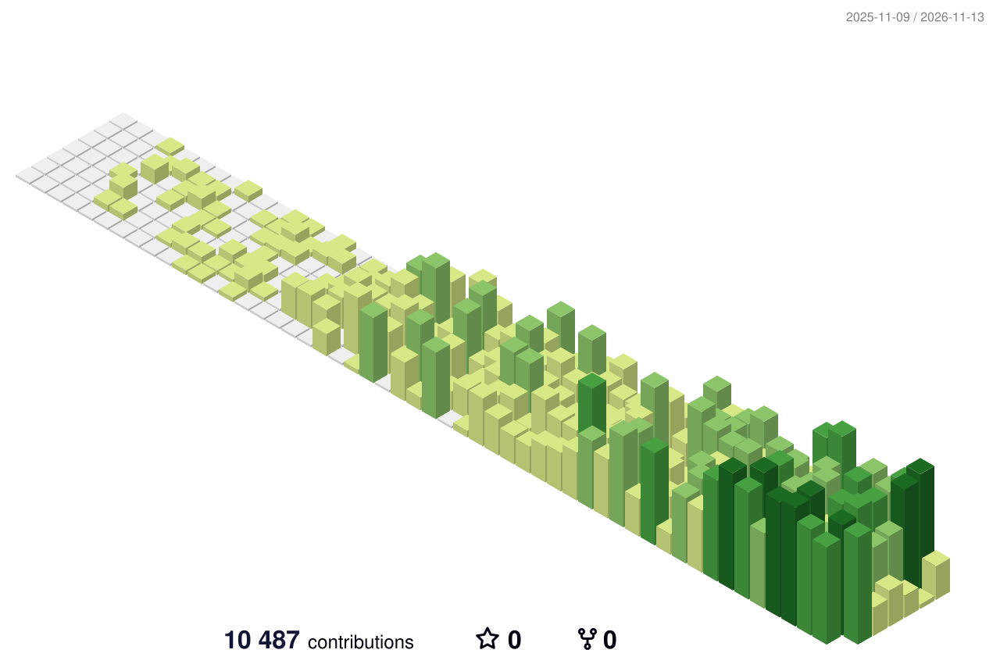

<!-- Header -->
<p align="center">
  
</p>

<p align="center">
  <a href="https://github.com/wlans01">
    
  </a>
</p>

<p align="center">
  
  
  
  
</p>

<br />

## About

```yaml
name: Choi Ji-moon (최지문)
role:
  - LiDAR 3D Perception Engineer
  - Physics-based R&D Engineer
company: GSI 지에스아이㈜ · R&D   # since 2025.12
domain: 항만 크레인 자동화
working_on:
  - 크레인용 LiDAR 인식 코어 — 화물 검출 · 추적 · ICP 정합
  - PLC 연동 실시간 런타임 — 검출 루프 · 출력 변환 체인 · Web UI
  - LiDAR extrinsics 정합 웹앱 — React + FastAPI + Open3D
background:
  - 레이저 현미경 시스템 시뮬레이션 · 광학 측정 데이터 분석
  - 머신비전 → 3D 점군 처리로 확장
```

## Tech Stack

<p align="center">
  
</p>

## Contributions

<p align="center">
  <picture>
    <source media="(prefers-color-scheme: dark)" srcset="https://raw.githubusercontent.com/wlans01/wlans01/output/3d/profile-night-green.svg" />
    <source media="(prefers-color-scheme: light)" srcset="https://raw.githubusercontent.com/wlans01/wlans01/output/3d/profile-green-animate.svg" />
    
  </picture>
</p>

<p align="center">
  <picture>
    <source media="(prefers-color-scheme: dark)" srcset="https://streak-stats.demolab.com?user=wlans01&background=0D1117&border=30363D&stroke=30363D&ring=39D353&fire=39D353&currStreakNum=E6EDF3&sideNums=E6EDF3&currStreakLabel=39D353&sideLabels=8B949E&dates=8B949E&hide_border=false&border_radius=8" />
    <source media="(prefers-color-scheme: light)" srcset="https://streak-stats.demolab.com?user=wlans01&background=FFFFFF&border=D0D7DE&stroke=D0D7DE&ring=216E39&fire=216E39&currStreakNum=1F2328&sideNums=1F2328&currStreakLabel=216E39&sideLabels=57606A&dates=57606A&border_radius=8" />
    
  </picture>
</p>

<p align="center">
  <picture>
    <source media="(prefers-color-scheme: dark)" srcset="https://raw.githubusercontent.com/wlans01/wlans01/output/snake-dark.svg" />
    <source media="(prefers-color-scheme: light)" srcset="https://raw.githubusercontent.com/wlans01/wlans01/output/snake.svg" />
    
  </picture>
</p>

## Earlier Work

| Project | 설명 | Stack |
|---|---|---|
| [LaserMicroscopySystemSimulation](https://github.com/wlans01/LaserMicroscopySystemSimulation) | 레이저 현미경 광학계 · 스캔 시스템 시뮬레이션 | Python |
| [WaveConverter](https://github.com/wlans01/WaveConverter) | 파장 · 주파수 · 각주파수 · 파수 · 광자 에너지 변환기 | C# / .NET |
| [Uniformity-analysis](https://github.com/wlans01/Uniformity-analysis) | 측정 데이터 균일도 분석 GUI 툴 | Python |
| [Gaussian-Fit](https://github.com/wlans01/Gaussian-Fit) | 가우시안 피팅 GUI 툴 | Python |

<!-- Footer -->
<p align="center">
  
</p>

